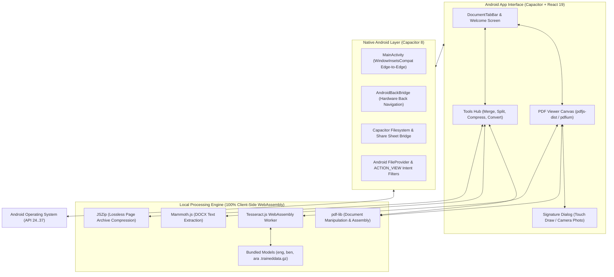

<p align="center">
  
</p>

<h1 align="center">Folio for Android</h1>

<p align="center">
  <strong>100% Offline PDF Reader, Editor, Smallpdf-Style Tools Hub, Multilingual OCR & Digital Signer for Android</strong>
</p>

<p align="center">
  <a href="https://github.com/djsusmith/folio_android/releases/latest"></a>
  <a href="https://github.com/djsusmith/folio_android/blob/main/LICENSE.txt"></a>
  <a href="https://djsusmith.github.io/folio_android/"></a>
  
  
  
</p>

<p align="center">
  <a href="#-quick-download"><strong>⬇️ Download APK (v1.0.0)</strong></a> •
  <a href="https://djsusmith.github.io/folio_android/"><strong>🌐 Official Website</strong></a> •
  <a href="#-key-features"><strong>✨ Features</strong></a> •
  <a href="#-comparison"><strong>📊 Comparison</strong></a> •
  <a href="#-architecture"><strong>🏗️ Architecture</strong></a> •
  <a href="#-building-from-source"><strong>🛠️ Build Guide</strong></a> •
  <a href="#-credits--license"><strong>📜 Credits</strong></a>
</p>

---

## 🚀 Overview

**Folio Android** (`com.folio.pdf`) is the standalone mobile edition and full evolution of [Folio](https://github.com/Forward-Future/folio) crafted specifically for Android. Built and maintained by **[djsusmith](https://github.com/djsusmith)**, it bridges high-performance client-side PDF rendering (`pdfjs-dist` + `@embedpdf/pdfium`) with an offline **Smallpdf-style Tools Hub**, pre-bundled **multilingual offline OCR (English, Bangla, Arabic)**, and a dedicated **touch / stylus signature pad**—**100% private, 0 ads, 0 telemetry, and completely free forever**.

Unlike proprietary cloud tools that upload sensitive documents to remote servers or lock basic operations behind monthly paywalls, every single byte in Folio Android is processed locally on your phone's processor using hardware WebAssembly.

---

## ⚡ Quick Download

Get the official, production-signed release APK directly from GitHub:

<p align="center">
  <a href="https://github.com/djsusmith/folio_android/releases/download/v1.0.0/folio-android-release.apk">
    
  </a>
</p>

| Metric | Specification |
| :--- | :--- |
| **Package Name** | `com.folio.pdf` |
| **Latest Version** | **v1.0.0** (Build 1) |
| **Target OS** | Android 7.0 (API 24) to Android 17 (API 37) |
| **Architecture** | Universal / ARM64 / x86_64 WebAssembly Engine |
| **Release Signing** | 2048-bit RSA Self-Signed Production Keystore (V1, V2, V3 APK Signing) |
| **Download Size** | ~21 MB (Includes bundled English, Bangla & Arabic neural OCR models) |
| **Security & Privacy** | 100% Free & Open Source (MIT), 0 Trackers, 0 Adware, 0 Cloud Uploads |

> [!TIP]
> **First-time Install Note (Google Play Protect):**
> Because Folio Android is an independent open-source release distributed directly via GitHub rather than the Google Play Store, Play Protect may prompt *"Play Protect hasn't seen this app before"*.
> Simply tap **"More details"** ➔ **"Install anyway"**. The entire codebase is 100% transparent, auditable, and open-source right here on GitHub.

---

## ✨ Key Features

### 🛠️ 1. Smallpdf-Style Offline Tools Hub
Open any PDF or launch the Tools Hub directly from the welcome screen:
- **Merge PDF:** Combine unlimited PDF files into a single consolidated document in your exact order.
- **Split / Extract Pages:** Extract single pages or custom ranges (e.g. `1-3, 5, 8-10`) into a fresh PDF.
- **Reorder & Organize:** Visually arrange, delete, and rotate pages before exporting.
- **Compress PDF:** Re-sample heavy pages with Light (Best Quality), Balanced, or Maximum (Smallest) presets.
- **Images → PDF:** Convert multiple PNG, JPEG, or WebP photos into a multi-page PDF document.
- **PDF → Images (ZIP):** Render every page at high DPI and export as lossless PNG or lightweight JPEG inside a ZIP archive.
- **DOCX → PDF:** Offline Word-to-PDF conversion with Canvas 2D font rendering preserving English, Bangla, and Arabic typography.

### 🌐 2. Pre-Bundled Multilingual Offline OCR (`eng` + `ben` + `ara`)
- **Ready Out-of-the-Box:** Includes pre-compiled Tesseract LSTM traineddata for **English**, **Bengali (বাংলা)**, and **Arabic (العربية)**.
- **Zero Network Dependency:** Recognize scanned documents and image-only PDFs anywhere—even in airplane mode.
- **Searchable PDF Export:** Automatically embeds an invisible text layer over scanned pages, making them fully searchable and selectable.

### ✍️ 3. Touch, Stylus & Camera Signature Suite
- **Draw Signature:** Full touch and stylus signature canvas with velocity smoothing, stroke trimming, and instant placement.
- **Camera Capture:** Photograph signatures on white paper; the intelligent edge detector and adaptive ink thresholding strip away paper shadows and background artifacts.
- **Placement & Resize:** Drag, snap to detected form fields, or fine-tune position and dimensions with on-screen handles.
- **Remembered Signatures:** Optionally save your signature unencrypted on-device for 1-tap signing on future documents.

### 📖 4. World-Class Reading & Annotation Engine
- **OLED Dark Mode & Night Reading:** Invert bright page backgrounds for comfortable reading in dark rooms while preserving photos and graphics in full color.
- **Freehand Ink & Highlighter:** Draw annotations, highlight text with smart snapping, and jot down marginal notes.
- **Text Box Annotations:** Insert custom typography, change font sizes, and position notes anywhere.
- **Multi-Tab Workspace:** Open multiple documents simultaneously and switch between them smoothly.

### 📱 5. Native Android System Integration
- **Edge-to-Edge Display Insets:** Native `WindowInsetsCompat` handling prevents status bars, camera hole cutouts, and navigation gestures from clipping controls.
- **Hardware Back Button:** Integrated back handler smoothly closes modals, dialogs, drawers, and search bars before exiting.
- **System File Associations:** Registered Android `ACTION_VIEW` intent filters open PDFs and DOCX files directly from WhatsApp, Telegram, Gmail, Chrome, and your file manager.
- **Share Sheet & FileProvider:** Export, print, or share signed and converted PDFs directly to Google Drive, WhatsApp, Bluetooth, or local storage.

### 🔒 6. Zero Bloat & AI Privacy Gate
- **Desktop Cloud AI Disabled:** Desktop third-party cloud AI vendors (OpenAI/Claude/OpenRouter) that send file data to external servers are completely removed on Android.
- **Optional On-Device AI Toggle:** An experimental toggle in Settings allows local, on-device AI integration without leaking documents or consuming background bandwidth.

---

## 📊 Comparison

| Feature | Folio Android | Smallpdf (Web / Mobile) | Adobe Acrobat Reader | CamScanner |
| :--- | :---: | :---: | :---: | :---: |
| **Cost** | **100% Free Forever** | \$12/mo paywall | Free / \$20/mo sub | Freemium / Watermarked |
| **Offline Privacy** | **100% Local (0 Cloud)** | Files uploaded to cloud | Cloud-linked | Cloud-linked |
| **Merge & Split Tools** | **Unlimited Offline** | 2 free tasks/day | Paid subscription | Paid subscription |
| **Offline Bangla & Arabic OCR** | **Included Built-in** | No | Paid add-on | Paid subscription |
| **Draw & Camera Signatures** | **Included Free** | Limited | Limited free | Watermarked |
| **Ads & Trackers** | **0 Ads, 0 Trackers** | Heavy advertising | Tracking SDKs | Heavy ads & popups |
| **Source Code** | **100% Open Source (MIT)** | Closed proprietary | Closed proprietary | Closed proprietary |

---

## 🏗️ Architecture



---

## 🛠️ Building from Source

### Prerequisites
- **Node.js:** v18.0.0 or higher
- **Java:** OpenJDK 17 or OpenJDK 21
- **Android SDK:** Platforms 34/35/36 with build-tools

### Build Steps

```bash
# 1. Clone repository
git clone https://github.com/djsusmith/folio_android.git
cd folio_android

# 2. Install dependencies
npm ci

# 3. Copy OCR neural models and PDF.js assets
npm run assets

# 4. Build web production bundle
npx vite build

# 5. Sync Capacitor Android project
npx cap sync android

# 6. Build production signed APK
cd android
./gradlew assembleRelease

# The output APK will be located at:
# android/app/build/outputs/apk/release/app-release.apk
```

---

## 📜 Credits & License

- **Android Port, Offline Tools Hub, Multilingual OCR & Signature Suite:**  
  Engineered and maintained by **[djsusmith](https://github.com/djsusmith)** ([djsusmith/folio_android](https://github.com/djsusmith/folio_android)).
- **Upstream Desktop Project:**  
  Based on [Folio](https://github.com/Forward-Future/folio) by Forward-Future, licensed under the **[MIT License](LICENSE.txt)**.
- **Third-Party Open Source Libraries:**  
  - [pdfjs-dist](https://github.com/mozilla/pdf.js) & [pdf-lib](https://github.com/Hopding/pdf-lib) (PDF parsing, editing & rendering)
  - [Tesseract.js](https://github.com/naptha/tesseract.js) (Offline neural optical character recognition)
  - [Capacitor](https://capacitorjs.com) (Native Android runtime bridge)
  - [Mammoth](https://github.com/mwilliamson/mammoth.js) (Word document conversion)
  - [JSZip](https://stuk.github.io/jszip/) (Client-side ZIP archive creation)

---

<p align="center">
  <sub>Built with ❤️ for privacy, speed, and freedom on Android.</sub>
</p>
